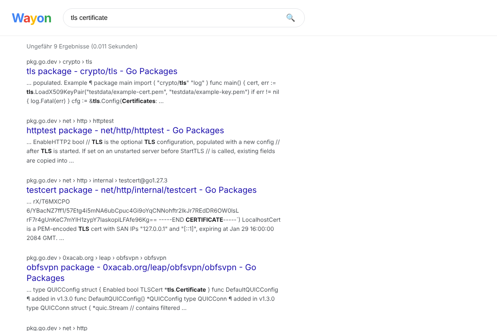

# Wayon

Wayon ist eine Websuchmaschine in **Rust** mit eigenem Crawler, eigenem invertierten Index und einer Weboberfläche wie bei großen Suchmaschinen. Sie ist auf geringen Ressourcenverbrauch ausgelegt: ein einziges Binary (ca. 10 MB), keine Datenbank, keine JVM und kein Garbage Collector. Der Index wird per `mmap` gelesen.




## Schnellstart

```bash
cargo build --release
B=target/release/wayon

# 1. Crawlen (fortsetzbar, Strg+C oder SIGTERM beendet sauber)
$B crawl https://example.org https://example.com --max-pages 5000

# 2. Index bauen
$B index

# 3. Suchen: Weboberfläche auf http://127.0.0.1:8080 …
$B serve --addr 127.0.0.1:8080
#    … oder direkt im Terminal
$B search "rust web crawler" -n 10
```

Alle Daten liegen unter `--data` (Standard `./data`): `data/crawl/` enthält die Rohdaten, `data/index/` den Suchindex.

### Befehle

| Befehl | Zweck |
|---|---|
| `crawl [SEEDS…]` | Seiten laden. Wichtige Optionen: `--seeds-file`, `--max-pages`, `--max-depth`, `--max-per-host`, `--concurrency`, `--delay-ms`, `--stay-on-domains`, `--domains a.de,b.de` |
| `index [--mem-mb 512]` | Index aus allen gecrawlten Seiten neu aufbauen; der fertige Index wird atomar ausgetauscht |
| `serve [--addr]` | Weboberfläche, JSON-API und Autovervollständigung starten |
| `search QUERY` | Suche im Terminal |
| `stats` | Dokumente, Terme und Größe jeder Indexdatei anzeigen |
| `dump [--filter]` | Gecrawlte Rohdaten prüfen |

### Suchsyntax

| Eingabe | Bedeutung |
|---|---|
| `rust crawler` | Alle Begriffe müssen vorkommen; Füllwörter wie „die“ oder „the“ sind optional |
| `"exakte phrase"` | Wörter direkt hintereinander, auch mit „…“ |
| `-wort` | Seiten mit diesem Wort ausschließen |
| `site:example.com` | Nur diese Domain inklusive Subdomains |
| `-site:example.com` | Diese Domain ausschließen |

### HTTP-API

- `GET /api/search?q=…&page=1&n=10` liefert Treffer als JSON (Titel, URL, Snippet, Score, Trefferzahl, Korrektur).
- `GET /api/suggest?q=…` liefert Vorschläge im OpenSearch-Format.
- `GET /opensearch.xml` macht Wayon im Browser als Suchmaschine hinzufügbar.

## Architektur

```
 Crawler ──► Crawl-Speicher ──► Index-Builder ──► Index (mmap) ──► Suche ──► HTTP/Web-UI
 (tokio)     (zstd-Segmente)    (rayon, SPIMI)    (FST + Bitpacking)
```

### Crawler (`src/crawler/`)
- Asynchron mit tokio und reqwest (rustls, HTTP/2, gzip/brotli). Pro Host läuft höchstens eine Anfrage gleichzeitig, mit Mindestpause dazwischen.
- **robots.txt** nach RFC 9309: User-agent-Gruppen, `Allow`/`Disallow` mit `*` und `$`, längste Regel gewinnt, `Crawl-delay`. **Sitemaps** werden gelesen, auch Sitemap-Indizes.
- `noindex`/`nofollow` aus Meta-Tag und `X-Robots-Tag` werden beachtet, ebenso `rel=nofollow`, `rel=canonical` und `<base href>`.
- Bei 429/503 wird die Pause verdoppelt bzw. `Retry-After` befolgt; nach erfolgreichen Anfragen sinkt sie wieder.
- Bereits gesehene URLs merkt sich ein **Bloom-Filter**: rund 1,2 Byte pro URL statt rund 100 Byte in einem HashSet.
- URL-Normalisierung: Fragmente, Tracking-Parameter (`utm_*`, `gclid` …) und Standardports werden entfernt. Die Zeichenkodierung wird erkannt (Header, BOM, `<meta charset>`).
- Bei der Textextraktion werden Navigation, Footer, Sidebars, Cookie-Banner, Scripts usw. übersprungen.
- Bei Abbruch wird die offene Warteschlange gespeichert; der nächste `crawl`-Aufruf setzt dort fort.

### Crawl-Speicher (`src/store.rs`)
Ein append-only Speicher: Jede Seite ist ein eigener zstd-Frame in Segmentdateien zu je 256 MB. Defekte oder abgeschnittene Records, etwa nach einem Absturz, werden übersprungen. Records lassen sich direkt adressieren und per mmap lesen.

### Index (`src/index/`)
Der Aufbau läuft in mehreren Phasen:
1. **Auswahl:** Pro URL zählt die neueste Version. `noindex`- und Fehlerseiten fallen weg. `rel=canonical` und inhaltsgleiche Duplikate werden zusammengefasst (Hash des Textes).
2. **Doc-IDs nach umgekehrtem Host sortiert** (`com.example.www/pfad`). Seiten derselben Domain liegen dadurch nebeneinander. Das ergibt kleine Doc-ID-Abstände für die Kompression und schnelle `site:`-Filter über ID-Bereiche.
3. **Linkgraph:** Ankertexte eingehender Links werden zum eigenen Suchfeld. Dazu kommt ein gewichteter **PageRank**, bei dem Links innerhalb derselben Domain weniger zählen.
4. **Invertierung (SPIMI, parallel):** Die Dokumente werden auf allen Kernen analysiert. Die Postings werden nach Term-Hash auf Shards verteilt, und jeder Shard läuft auf einem eigenen Thread. Ist das RAM-Budget (`--mem-mb`) erreicht, wird ein sortierter Lauf auf die Platte geschrieben.
5. **Merge:** Ein k-Wege-Merge erzeugt aus allen Läufen das kompakte Endformat.

**Dateiformat, auf geringen Platzbedarf optimiert:**

| Datei | Inhalt |
|---|---|
| `terms.fst` | Wörterbuch als *Finite State Transducer*. Gemeinsame Präfixe **und** Suffixe aller Terme werden geteilt; das ist meist kleiner als die Terme als reiner Text. |
| `postings.bin` | Pro Term Blöcke à 128 Dokumente. Doc-ID-Deltas und Termfrequenzen der 5 Felder (Titel, Überschriften, Text, URL, Ankertext) sind **bitgepackt**, Felder ohne Treffer kosten 1 Byte pro Block. Eine Skip-Tabelle erlaubt schnelles Springen, die Positionen (für Phrasen und Nähe) sind als Varint-Deltas gespeichert. |
| `docmeta.bin` | **8 Byte pro Dokument**: Feldlängen logarithmisch auf je 1 Byte quantisiert, PageRank, Sprache, URL-Tiefe |
| `docstore.bin/.idx` | Je 16 Dokumente (URL, Titel, Beschreibung, Text für Snippets) bilden einen zstd-Block (Level 12) |
| `hosts.bin` | Host → Doc-ID-Bereich |
| `words.fst` | Oberflächenwörter mit Häufigkeit, für „Meinten Sie“ und die Autovervollständigung |

### Suche und Ranking (`src/search/`)
- Die Auswertung läuft **Dokument für Dokument** über alle Postinglisten. Der seltenste Begriff führt, die anderen springen per Skip-Tabelle hinterher.
- **Stemming** für Deutsch und Englisch; Akzente und Umlaute werden normalisiert (ä→a, ß→ss). Ein Suchwort sucht automatisch nach allen Sprachvarianten, „Suchmaschinen“ findet also auch „Suchmaschine“.
- Das **Ranking** ist zweistufig:
  1. Alle Treffer werden mit **BM25F** über 5 gewichtete Felder bewertet, dazu PageRank, Bonus wenn alle Begriffe im Titel stehen, Bonus wenn ein Suchwort im Domainnamen steht (z. B. „github“ → github.com, Startseite bevorzugt) und ein Abzug für URL-Tiefe.
  2. Die besten 1.000 werden nach **Termnähe** neu sortiert (kleinstes Fenster, das alle Begriffe enthält).
- **Domain-Diversität:** Höchstens 2 Treffer pro Host stehen am Stück, weitere rücken nach hinten.
- **Gelockerte Suche:** Gibt es fast keine Treffer, darf ein Begriff fehlen.
- **Rechtschreibkorrektur:** Ein Levenshtein-Automat läuft über `words.fst` und erkennt auch Buchstabendreher. Ohne Treffer wird automatisch korrigiert („Ergebnisse für … werden angezeigt“).
- **Snippets** zeigen das Textfenster mit den meisten verschiedenen Suchbegriffen, die Treffer sind hervorgehoben.

## Messwerte

Gemessen auf 4 CPU-Kernen.

**Echter Crawl** (pkg.go.dev und pypi.org, 289 Dokumente nach Deduplizierung):

| | Wert |
|---|---|
| RAM Crawler | ca. 50–65 MB (davon 11,7 MB Bloom-Filter für 10 Mio. URLs) |
| RAM Server | **ca. 10 MB** nach 200 Anfragen (beim 200.000-Seiten-Index ca. 29 MB inklusive gemappter Indexseiten) |
| Antwortzeit | 1–4 ms |

**Synthetischer Lasttest**, erzeugbar mit `cargo run --release --example synth -- /tmp/synth 200000`:

| 200.000 Seiten, im Schnitt 450 Wörter | Wert |
|---|---|
| Rohtext im Crawl-Speicher | 305 MB |
| Index gesamt | 466 MB, davon invertierter Index **1,3 KB pro Dokument** inklusive Positionen; der Rest ist der komprimierte Dokumentspeicher für Snippets |
| Indexaufbau | ca. 2 min, Heap ca. 200–340 MB je nach `--mem-mb` |
| Suche: seltene Begriffe | 1–3 ms |
| Suche: sehr häufige Begriffe (Treffer in 100 % der Seiten) | 10–30 ms |
| Phrase aus zwei sehr häufigen Wörtern | ca. 80 ms |

## Tests

```bash
cargo test
```

Es gibt Unit-Tests für Kodierung, Postings, robots.txt, HTML-Extraktion, Tokenizer, Ranking-Hilfen usw. Dazu kommt ein **End-to-End-Test** (`tests/e2e.rs`): Er startet eine lokale Testseite, crawlt sie, baut den Index und prüft Phrasen, Ausschlüsse, `site:`, robots.txt, noindex, canonical, Duplikate, Tippfehler-Korrektur und Autovervollständigung.

## Grenzen und nächste Schritte

Wayon arbeitet mit denselben Verfahren wie große Suchmaschinen, ist aber für **eine einzelne Maschine** gebaut, also für Millionen statt Milliarden Seiten. Ausbaumöglichkeiten:
- **Block-Max-WAND**, damit Anfragen mit sehr häufigen Wörtern auf zweistelligen Millionen-Indizes schneller werden
- **Inkrementelle Index-Updates**; bisher wird der Index komplett neu gebaut, das aber parallel und mit begrenztem RAM
- **Verteilung:** den Index nach Doc-ID-Bereichen auf mehrere Maschinen aufteilen und die Ergebnisse zusammenführen
- Weitere Sprachen beim Stemming, Synonyme, Near-Duplicate-Erkennung (SimHash), Freshness-Signale, gelernte Ranking-Modelle
- JavaScript-lastige Seiten liefern ohne Headless-Browser kaum Text
